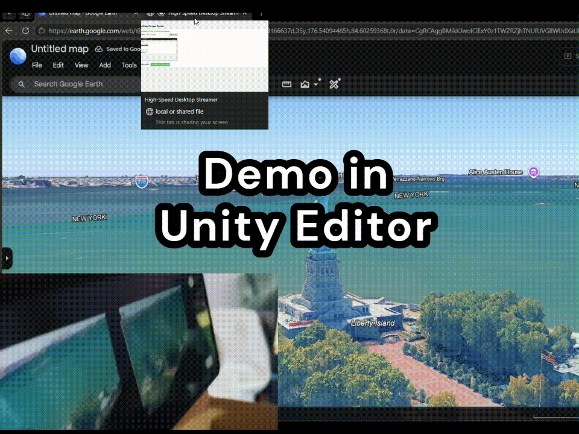
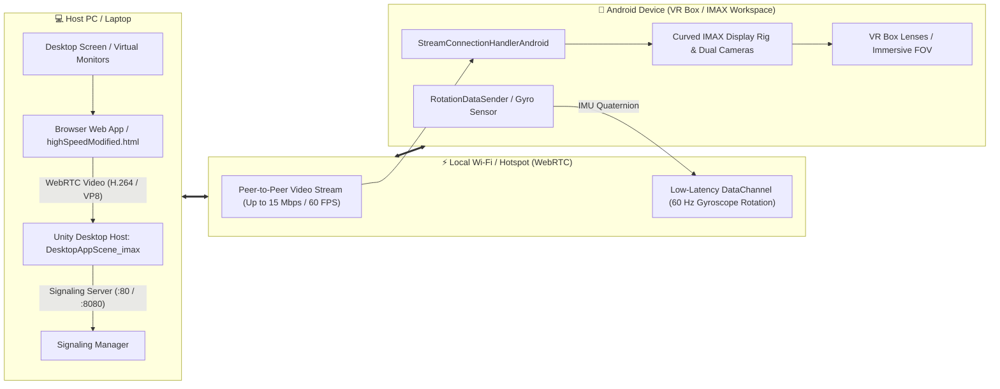

<div align="center">

# 👁️ VORTEK VISION

### *O workstation espacial de monitores virtuais que roda no celular que você já tem*

[-222?style=for-the-badge&logo=unity&logoColor=white)](https://unity.com/)
[](https://developers.google.com/ar)
[](https://webrtc.org/)
[](https://www.android.com/)
[](LICENSE)

**Multi-monitor espacial em tempo real: desktop espelhado, head-tracking 60 Hz e display IMAX curvo —
pareado com qualquer laptop + celular Android + VR Box / Google Cardboard.**

[✨ Features](#-key-features) • [🏗️ Arquitetura](#-system-architecture) • [🚀 Quick Start](#-quick-start-guide) • [🎮 Cenas](#-scenes--modes-directory) • [🔭 Roadmap](#-future-roadmap)

</div>

---

## 💡 The Vision

Óculos espaciais premium como **Apple Vision Pro** e **Meta Quest 3** entregam computação de
monitores virtuais, mas custam de **US$ 500 a US$ 3.500+**.

**Vortek Vision** derruba essa barreira: emparelhando o hardware que você **já possui** — um laptop
comum, um celular Android de entrada e uma VR Box / Google Cardboard — ele transforma qualquer
parede do seu quarto em um **workstation espacial de monitores virtuais** com latência
ultra-baixa, sem nenhum upgrade de hardware.

> **Custo do upgrade: zero.** O celular vira o display, o laptop vira o renderizador, o Wi-Fi vira o cabo.

---

## 🎬 Visual Demos

<div align="center">

### 👓 Handheld AR Spatial Anchor Workspace

*Plane detection no mundo real + espelhamento do desktop, ancorado na sua mesa.*

<br/>

### 🥽 Stereoscopic VR Box / Cardboard Workspace

*Renderização peer-to-peer com head-tracking giroscópico 60 Hz e campo de visão IMAX.*

> 💡 *Se os GIFs demorarem, os vídeos HD estão em [`Demos/`](Demos/): [ARWorkspace.mp4](Demos/ARWorkspace.mp4) & [VRWorkspace.mp4](Demos/VRWorkspace.mp4).*

</div>

---

## ✨ Key Features

| | Feature | Description |
| :---: | :--- | :--- |
| ⚡ | **Zero-Latency WebRTC Pipeline** | Streaming de tela peer-to-peer **sub-30ms** via Unity Render Streaming com codecs acelerados por hardware (H.264 / VP8). |
| 🥽 | **Stereoscopic 3D Dual-Camera Rig** | Renderer split-screen com IPD ajustável em runtime (~64 mm), feito sob medida para VR Box e Google Cardboard. |
| 🔄 | **Real-Time Gyro Head Tracking** | Dados do IMU do celular a **60 Hz** via WebRTC DataChannel, com suavização Quaternion Slerp e zero jitter. |
| 📈 | **Adaptive Quality Manager** | Escala dinâmica de bitrate de **2 → 15 Mbps @ 60 FPS** avaliando as condições da rede a cada 3 s. |
| 🌐 | **Smart Reconnection & Watchdog** | Normalização automática de IP (`ws://`, `http://`, IP puro), reconexão com backoff exponencial e watchdog de frame congelado. |
| 🖼️ | **IMAX & Curved Spatial Displays** | Quads espaciais planos ou displays curvos imersivos (modo IMAX) para máxima legibilidade. |
| 🔋 | **Thermal & Battery Optimization** | FPS-alvo configurável, DPI fixo e modos de tracking leves para evitar throttling térmico. |

---

## 🏗️ System Architecture



---

## 📂 Project Structure

```text
Vortek-vision/
├── Assets/
│   ├── Scenes/
│   │   ├── RemoteRenderingScenes/
│   │   │   ├── imax/                         # ⭐ Recommended IMAX Curved Spatial Scenes
│   │   │   │   ├── AndroidAppScene_imax.unity # Android IMAX VR client + Gyro sender
│   │   │   │   └── DesktopAppScene_imax.unity # Host PC IMAX renderer + remote camera
│   │   │   ├── AndroidAppScene 2.unity       # Flat quad Android VR client
│   │   │   └── DesktopAppScene 2.unity       # Flat quad Host PC receiver
│   │   ├── SplitScreenScene1.unity  # Stereoscopic rendering on Canvas Display
│   │   ├── SplitScreenScene2.unity  # Stereoscopic rendering for Google Cardboard
│   │   ├── ARMetaverseScene.unity   # AR Foundation plane-detection workspace
│   │   └── ARMetaverseSceneModified.unity # Rotation-only lightweight AR mode
│   ├── Scripts/                     # Core C# engine & networking scripts
│   │   ├── WebServerIPScript.cs            # URL normalization & auto-reconnect
│   │   ├── DynamicStreamQualityManager.cs  # Dynamic bitrate & FPS auto-scaler
│   │   ├── StreamConnectionHandlerAndroidScript.cs # Frame receiver & watchdog
│   │   ├── RotationDataSender.cs           # Android Gyroscope WebRTC sender
│   │   ├── RotationDataReceiver.cs         # Host PC Slerp smoothed receiver
│   │   ├── VRSplitScreenScript.cs          # Stereoscopic IPD camera controller
│   │   └── WebRTCOptimizerScript.cs        # Render Streaming performance tuner
│   └── Prefabs/                     # XR Origin, Quad Displays, UI Canvases
├── web app/
│   ├── highspeedScreenShare/
│   │   └── highSpeedModified.html   # ⭐ High-speed screen sharing dashboard with bitrate selector
│   ├── public1/
│   │   └── screenshare.html         # Screen capture UI
│   └── webserver.exe                # Lightweight standalone WebRTC signaling server
├── Demos/                           # High-res recordings & animated demo GIFs
├── DEVLOG.md                        # Complete chronological development history
└── IMPROVEMENTS_DOC.md              # Technical deep-dive & Unity Inspector guide
```

---

## 🎮 Scenes & Modes Directory

| Scene Name | Platform | Key Use Case |
| :--- | :--- | :--- |
| **`AndroidAppScene_imax`** ⭐ | Android | **Primary recommended VR Client:** Curved ultra-wide IMAX spatial workstation receiving desktop stream and broadcasting gyroscope orientation. |
| **`DesktopAppScene_imax`** ⭐ | Windows PC | **Primary recommended Host Renderer:** IMAX spatial camera host rendering screen to virtual curved display and rotating camera with head movement. |
| **`AndroidAppScene 2`** | Android | Flat quad VR Box client with gyroscope orientation sender. |
| **`DesktopAppScene 2`** | Windows PC | Flat quad Host PC receiver. |
| **`SplitScreenScene2`** | Android | Standalone Cardboard stereoscopic split-screen mode. |
| **`ARMetaverseSceneModified`** | Android | High-performance AR mode with plane detection disabled (reduces CPU usage & heat). |
| **`ARMetaverseScene`** | Android | Full ARCore plane detection & spatial anchor placement on real physical tables/walls. |

---

## 🚀 Quick Start Guide

### 📋 Prerequisites
1. **Host PC:** Windows 10/11 with Google Chrome or Microsoft Edge.
2. **Android Device:** Android 7.0+ (com giroscópio — necessário para o head-tracking VR Box/Cardboard).
3. **Unity Editor:** **Unity 6 (6000.4.0f1 ou newer Unity 6 LTS)** com **Android Build Support**.
4. **Network:** Ambos os dispositivos na **mesma** rede Wi-Fi (roteador ou hotspot).

---

### Step 1: Start the Signaling Server
```bash
cd "web app"
./webserver.exe
```
*Anoto o IP local exibido no terminal (ex.: `192.168.1.50:80`).*

---

### Step 2: Launch the Desktop Screen Sharer
1. Abra no navegador:
   ```text
   http://localhost:80/highspeedScreenShare/highSpeedModified.html
   ```
2. Clique em **Start Screen Share** e escolha a tela/janela a ser espelhada.
3. Selecione o perfil de bitrate (**15 Mbps Ultra**, **10 Mbps High** ou **5 Mbps Balanced**).

---

### Step 3: Build & Deploy IMAX App to Android
1. Abra o projeto no Unity Hub.
2. **File > Build Settings** → plataforma **Android**.
3. Selecione `Assets/Scenes/RemoteRenderingScenes/imax/AndroidAppScene_imax.unity` (ou instale o APK pré-compilado).
4. **Build and Run** para instalar no celular.

---

### Step 4: Run the Host Desktop IMAX Scene & Connect
1. No PC, abra e dê **Play** em `Assets/Scenes/RemoteRenderingScenes/imax/DesktopAppScene_imax.unity`.
2. No celular:
   - Abra o app **Vortek Vision**;
   - Digite o IP do PC (salvo automaticamente nas próximas vezes);
   - Toque em **Connect** e coloque o celular na VR Box.
3. Aproveite o workspace espacial curvo 360° flutuando na sua mesa! 🎉

---

## ⚙️ Configuration & Inspector Reference

<details>
<summary><b>🔧 Click to expand Unity Inspector Setup Instructions</b></summary>

### 1. `WebServerIPScript.cs` (Connection Management)
- **Server Address Input Field:** Assign your UI `TMP_InputField`.
- **Connection Status Text:** Assign UI `TMP_Text` for live status indicators.
- **Auto Reconnect On Disconnect:** `True` (exponential retry interval).
- **Load Saved Url On Start:** `True` (`PlayerPrefs` persistent memory).

### 2. `DynamicStreamQualityManager.cs` (Bitrate Control)
- **Min Bitrate:** `2000 Kbps` (2 Mbps for congested networks).
- **Max Bitrate:** `15000 Kbps` (15 Mbps for crystal-clear code & text reading).
- **Evaluation Interval:** `3.0 seconds`.

### 3. `RotationDataReceiver.cs` (PC Host Head Tracking)
- **Connection ID:** `InputStream`.
- **Smooth Factor:** `20` (Quaternion Slerp interpolation for butter-smooth rotation).
- **Initial Rotation Offset:** `(90, 0, 0)` (adjust based on phone mounting orientation).

### 4. `VRSplitScreenScript.cs` (Stereoscopic Rig)
- **Left Eye Camera:** Tracked Main Camera.
- **Interpupillary Distance (IPD):** `0.064` (64mm human average).

</details>

---

## 🔮 Future Roadmap

- [ ] **Virtual Multi-Monitor Expansion:** Multi-track WebRTC pipeline allowing 3+ distinct virtual monitors arranged in a 180° spatial arc.
- [ ] **Smartphone as Laser Pointer / Virtual Trackpad:** Utilize the phone screen as a 3DoF spatial pointer and mouse trackpad when unmounted.
- [ ] **mDNS Zero-Config Discovery:** Automatic LAN UDP broadcast to auto-pair Android devices with the host PC without typing IP addresses.
- [ ] **Passthrough Blend Toggle:** One-tap toggle between VR dark theater mode and AR camera passthrough.
- [ ] **WebXR Integration:** Direct browser-based WebXR client compatibility.

---

## 🤝 Contributing

Contributions, feature suggestions, and bug reports are warmly welcome!
1. Fork the repository.
2. Create your feature branch (`git checkout -b feature/AmazingFeature`).
3. Commit your changes (`git commit -m 'Add some AmazingFeature'`).
4. Push to the branch (`git push origin feature/AmazingFeature`).
5. Open a **Pull Request**.

---

## 📜 License

This project is licensed under the **MIT License** — see the [LICENSE](LICENSE) file for details.

---

<div align="center">

Made with ❤️ by **Vortek-Zero**

⭐ **Se o projeto te impressionar, deixe uma estrela!** ⭐

</div>
